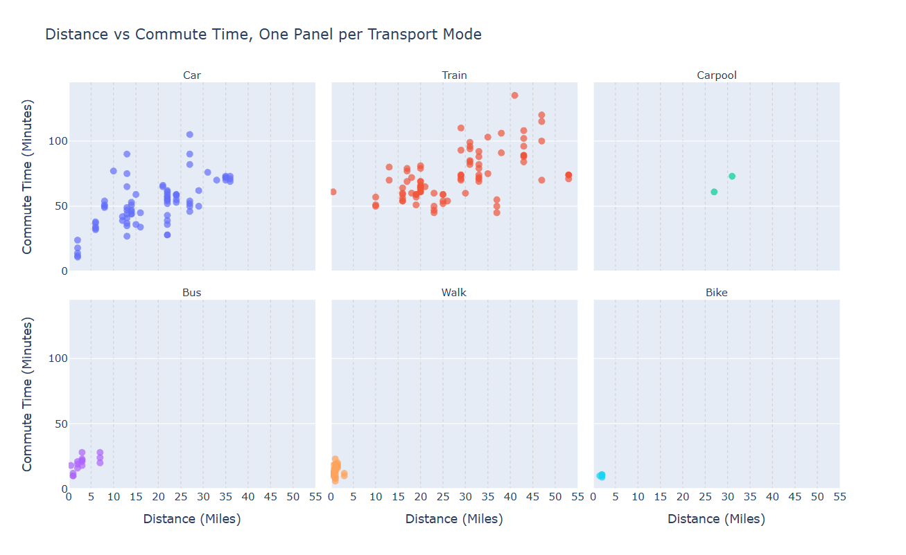
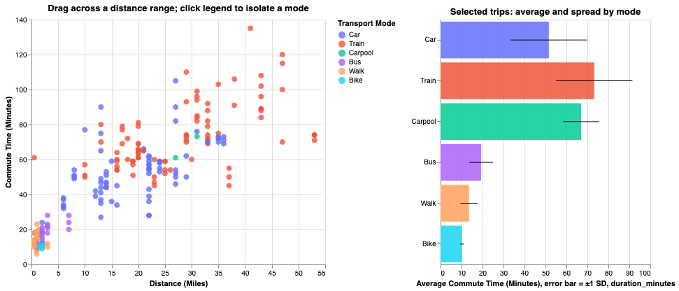
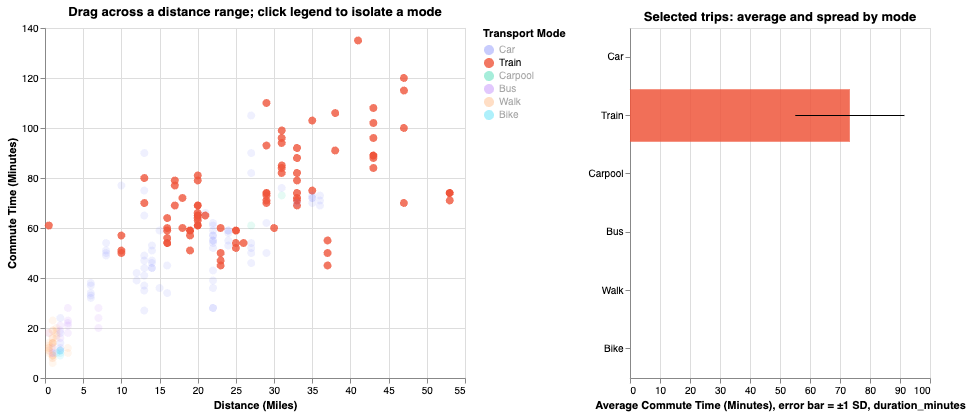

# Assignment 3: Interaction and Evaluation

## Task 1: Implementing interaction (20%)

**Visualization 1: Distance vs. Commute Time by Transport Mode (Scatterplot)**
Static version: A single scatterplot of distance versus commute time, with each trip colored by transport mode. It shows the general trend (longer trips take longer) and lets viewers see every individual trip. Because many trips cluster at similar distances and times, points overlap, which makes it hard to compare modes within a specific distance range or judge how consistent each mode’s commute times are.

Interactive version: The same scatterplot, with the same colors and data, plus three interactions:

- Brushing and linking (the main interaction): Viewers drag across a distance range on the scatterplot, and a linked chart shows the average commute time, spread (±1 standard deviation), and trip count for each mode within that range. This replaces eyeballing overlapping dots with a direct comparison of modes at similar distances.
- Legend selection: Clicking a mode in the legend isolates it in both charts and fades the others, so viewers can focus on one mode at a time.
- Details on demand: Hovering over a point shows its day, weather, location, distance, and duration, and hovering over a summary bar shows its mean, standard deviation, and trip count.

Why we expect it to help: Our analytical question is whether some modes, such as trains, have more predictable commute times than others, such as cars. That is a question about spread at comparable distances, which is hard to read from overlapping points. Brushing lets a viewer fix the distance range and compare average and spread across modes directly, so we expect faster and more accurate answers to tasks like “Which mode has the most consistent commute time for trips of 10-20 miles?”

**Visualization 2: Average Commute Time by Day of the Week (Bar Chart)**
Static Version: A standard bar chart showing the overall average commute time for Monday through Friday.

/ insert visualization here /

Interactive Version: added filtering via a grouped bar chart and interactive legend. Users can click on a transportation mode in the legend (e.g., "Car") to remove the other modes from the chart. This allows them to see if a bad commute day (like Monday) is driven by car traffic, or if it affects trains and buses equally.

/ insert visualization here /

## Task 2: Evaluation design (20%)

### Scatterplot: Static vs. Interactive

**Evaluation question**
Does brushing a distance range on the scatterplot make it easier to compare how steady commute times are across transportation modes at a similar distance?

**Hypotheses**

- **Accuracy Hypothesis:** Participants will answer comparison questions more correctly with the interactive scatterplot than with the static scatterplot.
- **Speed Hypothesis** Participants will answer comparison questions faster with the interactive scatterplot than with the static scatterplot.

**Reasoning**
In the static scatterplot, dots from different modes overlap heavily within a distance band, so participants have to estimate average and spread by eye. In the interactive version, brushing a distance range updates a linked bar chart that shows each mode's average commute time, its spread (±1 SD), and its trip count for the selected range. The comparison can be read directly from the summary chart.

**Analytical tasks**
There are two tasks, and each has two variants that ask the same kind of question about different distance ranges. Together they make four questions.

Task 1: Compare average commute time\*

- Variant A: Between Car and Train trips that are 10–20 miles long, which mode has the higher average commute time?
- Variant B: Between Car and Train trips that are 30–40 miles long, which mode has the higher average commute time?

Task 2: Compare consistency (spread) across modes\*

- Variant A: Between Car and Train trips that are 10–20 miles long, which mode has the more consistent commute time?
- Variant B: Between Car and Train trips that are 30–40 miles long, which mode has the more consistent commute time?

**Why these tasks**

- Each task compares two values, not one obvious dot, so it requires more than reading a single value.
- Task 1 compares averages. The static plot forces estimation from dots; the interactive plot shows the mean directly.
- Task 2 compares spread, which is the core question behind the hypotheses and is hard to judge from the static plot.
- Only Car and Train are used because they are the only modes with enough trips in both ranges. Carpool, Bus, Walk, and Bike are excluded.
- Each answer is one of two choices, so accuracy is easy to score.

**Design**

- Within-subject: every participant completes both conditions.
- Each participant answers four questions in total: one variant of Task 1 and one variant of Task 2 in the static condition, and the other variant of each task in the interactive condition.

**Counterbalancing**
There are four participant groups. Each group is defined by two choices: which variant of each task goes to the static condition, and which condition is presented first.

| Group | Presented first | Static condition                   | Interactive condition              |
| ----- | --------------- | ---------------------------------- | ---------------------------------- |
| 1     | Static          | Task 1 Variant A, Task 2 Variant A | Task 1 Variant B, Task 2 Variant B |
| 2     | Static          | Task 1 Variant B, Task 2 Variant B | Task 1 Variant A, Task 2 Variant A |
| 3     | Interactive     | Task 1 Variant A, Task 2 Variant A | Task 1 Variant B, Task 2 Variant B |
| 4     | Interactive     | Task 1 Variant B, Task 2 Variant B | Task 1 Variant A, Task 2 Variant A |

- Across the groups, each condition receives Train-answer and Car-answer Task 2 questions equally often, so the answer pattern is not confounded with condition.
- Assign participants to groups in rotation as they arrive, aiming for an equal number per group. Target at least 12 participants (3 per group), which is above the required 10 excluding pilots.

**Measurements**

- Accuracy: correct (1) or incorrect (0) for each question.
- Completion time: seconds from when the question is displayed until the participant submits an answer.
- Time limit: 1 Minute. Timed-out questions are recorded as incorrect, with the time limit as the completion time.
- Incomplete answers (no choice selected) are recorded as incorrect.

_Brush rule (interactive condition)_

- Participants are told to brush across the range shown in the prompt.
- Trips are assigned to a range using the inclusive rule: 10 ≤ distance ≤ 20 miles, or 30 ≤ distance ≤ 40 miles.
- If a brush clearly misses an edge, the answer is scored as recorded. The expected answer is always computed with the inclusive rule.

**Expected answers**
Computed from `commutes_clean.csv` using the inclusive rule. Gap is the difference in average commute time (Task 1) or in SD (Task 2).

| Task | Variant | Range    | Expected answer         | Gap          |
| ---- | ------- | -------- | ----------------------- | ------------ |
| 1    | A       | 10–20 mi | Train (higher average)  | 14.71 min    |
| 1    | B       | 30–40 mi | Train (higher average)  | 7.86 min     |
| 2    | A       | 10–20 mi | Train (more consistent) | 6.63 min SD  |
| 2    | B       | 30–40 mi | Car (more consistent)   | 14.61 min SD |

Supporting counts: Variant A has 23 Car and 34 Train trips. Variant B has 9 Car and 22 Train trips.

**Known limitations of the design**

- Task 1 has Train as the answer in both variants, so a participant who always chooses Train is correct on Task 1.
- Variant B's Car group has 9 trips from a small number of routes, so its spread estimate is unstable.
- The variants are not matched in difficulty: Task 1's gap is 14.71 min in A and 7.86 min in B; Task 2's SD gap is 6.63 min in A and 14.61 min in B.
- Variant A has 17 trips exactly on the 10- or 20-mile edges. The inclusive brush rule handles this but does not remove the sensitivity.
- Only Car and Train are compared, so results describe those two modes and not the full set of transport options.

### Procedure

**Setup**

- Use the same laptop and browser for every session. Open the static and interactive scatterplot files from local copies, not the internet, so a connection drop can't affect one condition.
- Set the screen to the same zoom level and brightness for each participant.
- Have a timer that starts when the question appears and stops when the participant clicks Submit. Use a script or screen recorder so timing is consistent.
- Have a spreadsheet open with one row per question, pre-filled with the participant ID, group, condition, task, and variant.

**Before the session**

- Assign the participant an anonymous ID (P01, P02, ...) and the next group in rotation (1 to 4).
- Look up the group in the Counterbalancing table to get the order of conditions and the variant for each question.

**Participant instructions (read aloud, same wording every time)**
"Thanks for helping with this. You'll look at a chart of commute trips in the Chicago area and answer four questions about it. Each question asks you to compare Car and Train trips in a distance range. Please answer as accurately as you can, and try to answer each question on your own. You can use any part of the chart. You have a time limit of 1 minute for each question. Do you have any questions before we start?"

**Interactive condition only (read before the first interactive question)**
"In this version you can drag across the chart to select a distance range. The summary chart on the right updates to show each mode's average and spread for that range. You can also click a mode in the legend to isolate it. Try it once before answering."

Give the participant 30 seconds to practice, then ask them to reset the brush before the first question.

**Each question**

1. Show the question and the chart in the condition for that question.
2. Start the timer as the question appears.
3. The participant answers by choosing Car or Train, then clicks Submit.
4. Stop the timer on Submit. Record the time in seconds.
5. If the time limit is reached before Submit, record the question as timed out.
6. Record the answer as correct or incorrect against the expected answer in the table.
7. Do not give feedback on correctness during the session.

**Between conditions**

- Give a 60-second break between the two conditions.
- Do not show the expected answers or discuss the results.

**After the session**

- Ask two short questions: "How confident were you in your answers, 1 to 5?" and "Which version did you find easier to use?"
- Thank the participant and do not share results.

**Recording**

- Enter every question as one row: participant ID, group, condition, presentation order, task, variant, answer given, correct (1/0), time in seconds, timed out (yes/no).
- Save the spreadsheet after each session. Do not edit the rows once entered; correct mistakes in a separate note column.
- The time limit and the wording of the instructions stay fixed for the whole study. Changes after the pilot are recorded in the report.

## Task 3: Conducting the evaluation (25%)

We have created the following csv file where you can find all the data collected from this experiment.

The anonymized results are in [`data/assignment3Experiment.csv`](data/assignment3Experiment.csv).

Data Dictionary for our CSV file:

| Column             | What                                                            | Variable Type | Example                    |
| ------------------ | --------------------------------------------------------------- | ------------- | -------------------------- |
| participant_id     | participant identifier (P01 to P12)                             | string        | P01                        |
| group              | group number for task 2's counterbalancing (1 to 4)             | int           | 1                          |
| is_pilot           | was this session part of the pilot?                             | string        | yes / no                   |
| presentation_order | which condition was shown first                                 | string        | static / interactive       |
| question_order     | order the question was asked within the session (1 to 4)        | int           | 1                          |
| condition          | which visualization the participant was shown for this question | string        | static / interactive       |
| task               | task number the question belongs to                             | int           | 1 or 2                     |
| variant            | which variant the question is                                   | string        | A or B                     |
| range              | distance range the question asks about                          | string        | 10-20 or 30-40             |
| expected_answer    | correct answer to the question                                  | string        | Car / Train                |
| answer_given       | answer the participant gave                                     | string        | Car / Train                |
| correct            | was the answer correct                                          | int           | 1 = correct, 0 = incorrect |
| time_seconds       | time spent on the question, in seconds                          | number        | 20.4                       |
| timed_out          | did the participant exceed the time limit                       | int           | 1 = yes, 0 = no            |

### Pilot evaluation

**Purpose**
Before the main study, we ran a pilot with two participants (P01 and P02) to check the instructions, question wording, timing procedure, and brush interaction. Pilot rows are marked `is_pilot = yes` and are excluded from the main analysis. With two participants, the pilot is for checking the procedure, not for comparing conditions.

Each pilot participant completed both conditions following the Task 2 procedure: one variant of Task 1 and one variant of Task 2 in each condition.

**Results**

- Task 1: 4 of 4 answers were correct. Mean time was 16.5 seconds.
- Task 2: 1 of 4 answers was correct. Mean time was 12.3 seconds. Three of the four answers were "Train" where the expected answer was "Car" or "Car" where the expected answer was "Train."
- Static condition: 3 of 4 correct, mean time 20.3 seconds.
- Interactive condition: 2 of 4 correct, mean time 8.5 seconds. Both Task 2 answers in this condition were incorrect.

**What we found**

- Both participants were confused by the original Task 2 wording, "Which mode has the more consistent commute time?" Both asked what "consistent" meant before answering, and their answers suggested different interpretations (for example, "most common" or "closest to the average").
- Task 2 was the question that failed in the pilot. Task 1 wording worked as written.
- P01 answered an interactive Task 2 question in 4 seconds and got it wrong, which may indicate guessing rather than reading the summary chart. Note this in the report.
- [add any other issues here along with their fixes below]

**Change made after the pilot**
The Task 2 question was reworded to define consistency explicitly:

- Original: "Which mode has the more consistent commute time?"
- Revised: "Which commute type had more consistent commute times, meaning the one with the smaller standard deviation?"

The revised wording was used for all main-study sessions. Task 1 wording and the expected answers did not change. Lower SD means more consistent, so scoring is the same under both wordings.

**Effect on the study**

- Pilot Task 2 answers were given under the original wording and are excluded from the analysis.
- The change was made before the main study began. The tasks, expected answers, and procedure were not changed after that point.

**After conducting our Pilot study, we had in total 10 participants for our experiment (P03-P12)**

### Visual Observations from the Main Study

**Task 1 was answered correctly in every session.** All 20 Task 1 answers were correct, and the interactive condition was faster on average (14.5 seconds versus 18.4 seconds in the static condition). Averages were easy to compare in both versions.

**Task 2 errors clustered in Variant B.** All four incorrect Task 2 answers were in the 30–40 mile range, where Car is the more consistent mode. In each case the participant chose Train. Variant A (10–20 miles) was answered correctly 10 of 10 times. Most participants mentioned after the study that the reason they answered train for this question, was because they assumed all the answers were going to be train.

**The interactive condition did not speed up Task 2.** Task 2 averaged 15.4 seconds in the interactive condition and 13.7 seconds in the static condition. Most participants didn't utilize isolating one singular mode of transportation in order to identify the more consistent type. Which could have resulted in this spread.

## Task 4: Quantitative analysis (25%)

**Descriptive Statistics**
Descriptive statistics for task accuracy and completion time, separately for each condition.

| Condition   | Total   | Correct  | Accuracy    | Mean time (s) | Median | Min-Max | SD
| -----       | ------- | -------- | ------------| ------------  | -------|--------|----
| Static      | 20      | 17       | 85%         |16.05          |16.5    |6-27    | 6.3
| Interactive | 20      | 19       | 95%         | 14.95         |15.0    |3-29    | 5.6

| Presented first | Task       | Correct   | Accuracy | Mean time (s) | SD
| --------------- | -----------|---------- | -------- |---------------|-----
| Static          | Task 1     | 10/10     | 100%     | 18.4          | 6.1
| Static          | Task 1     | 7/10      | 70%      | 13.7          | 5.8
| Interactive     | Task 1     | 10/10     | 100%     | 14.5          | 4.0
| Interactive     | Task 1     | 9/10      | 90%      | 15.4          | 7.0

**Chart 1: Task accuracy: Whether participants correctly complete each task**

**Chart 2: Task completion time: The time, in seconds, required to complete each task**

**Conditions and tasks:**
* All participants gave the correct answer expected for Task 1
* 70% of participants for Task 2 static condition gave the correct expected answer and 90% of participants for interactive condition gave the correct answer
* Interactive condition was faster for Task 1
* Interactive condition was a little slower for Task 2

**Participants:**
* 5 out of 10 participants were faster with interactive visualizations
* Participants with id P03, P04, P07 and P10 answered task 2 variant B incorrectly. For 3 of them condition was static and for 1 was Interactive
* 4 participants saw static version first and 6 saw interactive first. This is a difference between participants since it’s not split equally

## Task 5: Reflection and recommendations (10%)

## Extra Credit: Interactive Prototype using Curio
